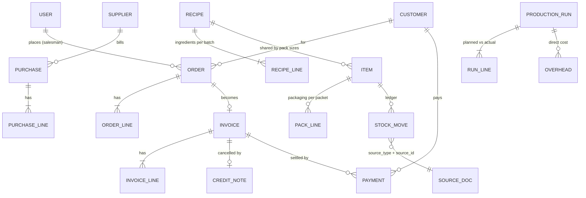

# Design note: Order-to-Audit

## 1. Data model

- **One `items` table** holds raw materials, packaging and finished packs (`kind`). Each has a stock unit (kg, l, pc, pkt).
- **The BOM is split in two**, so pack sizes can share a recipe:
  - `recipes` + `recipe_lines`: the ingredients for one batch, and the grams of finished product the batch gives (`output_g` = 40,000 g for murukku).
  - `pack_lines`: the packaging needed per packet of one pack size (1 pouch, 1/20 carton).
  - Expected packets = `output_g × batches ÷ pack weight`. That gives 200 for the 200 g pack; a 500 g pack added later would give 80, with no new recipe needed.
- **`stock_moves` is the only place stock changes.** There is no stock column anywhere.
  - Every row has a signed qty in the item's stock unit, a unit cost, a value, a move type, and `source_type` + `source_id` pointing to the purchase, production run, invoice, credit note or opening entry that caused it.
  - Balance = `SUM(qty)` and stock value = `SUM(value)`, so both are always derived from the ledger.
- Money is `NUMERIC(14,2)`, quantities `NUMERIC(14,3)` and rates `NUMERIC(14,4)`, handled as Python `Decimal` throughout. No floats.
- **`audit_log`** records user, time, action, and before/after JSON for every document created, edited, approved, rejected, dispatched or cancelled.
- **`doc_counters`** numbers invoices and credit notes per financial year. A row lock stops two clerks getting the same number.

## 2. How stock moves

| Event | Ledger rows |
| --- | --- |
| Opening balance | `OPENING` +qty per item |
| Purchase | `PURCHASE` +qty, valued at the bill amount (converted to the stock unit, e.g. g → kg) |
| Production run | `PROD_ISSUE` −actual qty for every input, then `PROD_OUTPUT` +good packets for the product |
| Dispatch | `DISPATCH` −packets per invoice line |
| Credit note on a dispatched invoice | `SALES_RETURN` +packets, at the same cost they left at |

- An issue that would take a balance below zero is refused.
- Every report balances: **opening + receipts − issues ± adjustments = closing**. The stock summary asserts this for each item.

## 3. BOM consumption and variance

When the supervisor saves a run, all of the following happens in one transaction:

1. **Planned quantities:**
   - Recipe inputs = recipe quantity × batches.
   - Packaging = per-packet quantity × **actual good packets**, because a pouch is only needed for a packet that was made. Count items are rounded down to whole pieces, so 188 packets plan 188 pouches and 9 full cartons.
2. **Actual quantities** are what was issued, in any unit of the same dimension (e.g. 10,500 ml is converted to 10.5 l). Damaged pieces are entered separately but are part of the issue.
3. Each input leaves stock at its weighted-average cost (`PROD_ISSUE`). Good packets enter finished goods at the run's material cost (`PROD_OUTPUT`).
4. **Variance** = (actual − planned) ÷ planned, for each input and for yield. Anything beyond the tolerance (a setting, 3% by default) is flagged on the run, the production report and the owner dashboard.

Benchmark run results:
- Yield: 188 vs 200 = **−6%, flagged**.
- Oil: 10.5 vs 10 = **+5%, flagged**.
- Pouches: 194 issued vs 188 planned = **+3.19%, flagged**, because of the 6 damaged.

## 4. Sales loop and stock check

The order flow is SUBMITTED → APPROVED → INVOICED → DISPATCHED (or REJECTED).

- **Before approving**, the admin sees, per product: on hand, committed (approved or invoiced but not yet dispatched), available, and shortage.
  - An order that is short cannot be approved. The admin can cut it to what's available (the edit is audited), wait for production, or reject it.
  - Distributor B's 120-packet order shows **short by 32** (88 available). If it were invoiced it would carry IGST, because Karnataka (29) is a different state from the factory (33).
- **GST:**
  - Place of supply is the buyer's state. Same state → CGST + SGST at half the rate each; different state → IGST at the full rate.
  - Tax is rounded per line, half-up to the paisa, and the invoice totals are sums of the rounded lines, so the printed figures always add up.
- **Finished-goods stock** goes down only at dispatch.
- **Payments** are recorded against an invoice, or on account (settling the oldest invoice first). Outstanding = posted invoices − payments.
- **Cancellation** never deletes anything: a credit note reverses the tax and the receivable, and dispatched goods come back into stock.
- **Offline orders:** the phone generates a `client_ref` (UUID) for each order, and the server stores each `client_ref` only once. Re-sending a queued order after a dropped connection therefore cannot duplicate it.

## 5. Costing and valuation

- **Valuation method: perpetual weighted average.**
  - Flour from different purchases is tipped into the same bin, so there is no physical first-in lot for FIFO to follow.
  - Last-price costing would overstate or understate stock whenever prices move.
  - Weighted average follows how the material is actually used, and it is an accepted method under Ind AS 2.
  - Example: after the purchase, flour = (100 × 42 + 60 × 45) ÷ 160 = ₹43.125/kg.
- **Overheads:**
  - An overhead entered against a run goes 100% to that run.
  - A monthly pool (e.g. the electricity bill) is shared between that month's runs **by kg of good output**. Frying time, gas and labour scale with dough fried, not with how many pouches it fills.
- **Cost per packet** = (material actually issued, wastage included + overheads) ÷ good packets.

| Benchmark run | ₹ |
| --- | --- |
| Flour 40 kg × 43.125 | 1,725.00 |
| Oil 10.5 l × 140 | 1,470.00 |
| Spice mix 1.2 kg × 200 | 240.00 |
| Pouches 194 × 2.50 (6 damaged included) | 485.00 |
| Cartons 9 × 15 | 135.00 |
| **Material** | **4,055.00** (21.57 per packet) |
| Labour 1,200 + gas/power 600 | 1,800.00 |
| **Total ÷ 188 good packets** | **31.14 per packet**; margin at ₹50 = ₹18.86 (37.7%) |

- **Finished-goods stock is valued at material cost only** in the ledger.
  - Overheads are usually entered after the run, sometimes after the packets have been sold. Adding them to the ledger value later would change the cost of goods that already left.
  - Instead, overheads are added in the cost-per-packet report and on the dashboard.
- The opening 50 packets are valued at the standard material cost at opening prices: (40 × 42 + 10 × 140 + 1.2 × 200 + 200 × 2.5 + 10 × 15) ÷ 200 = ₹19.85.
